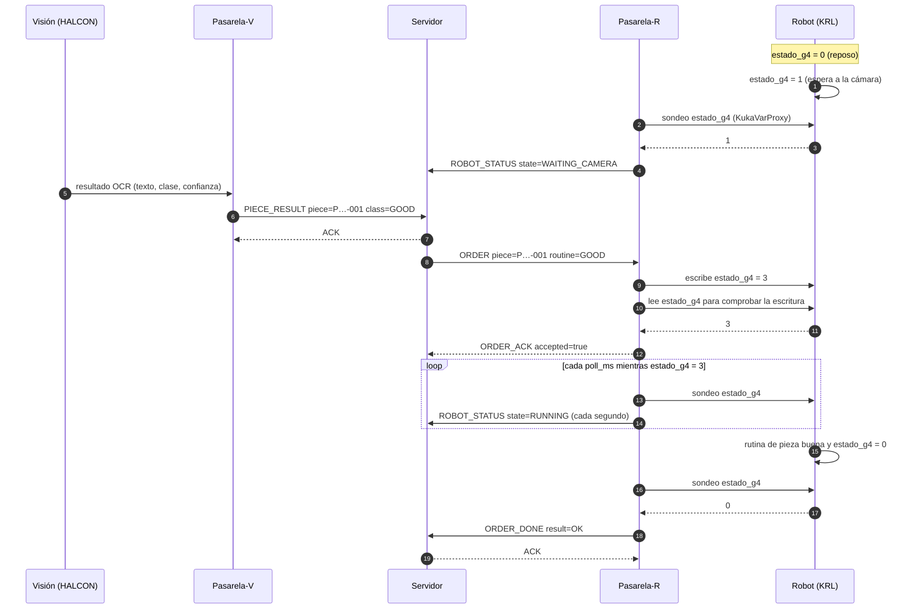
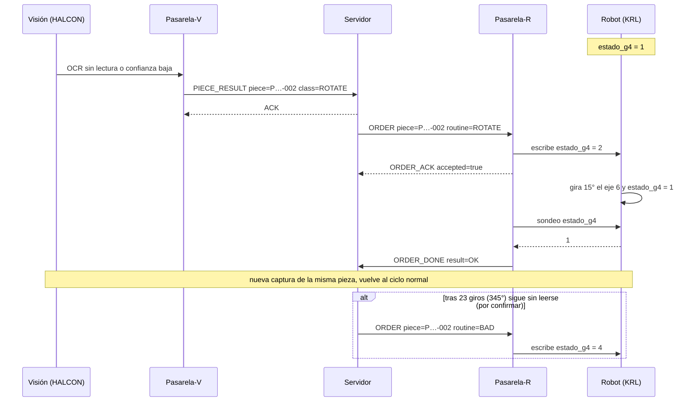
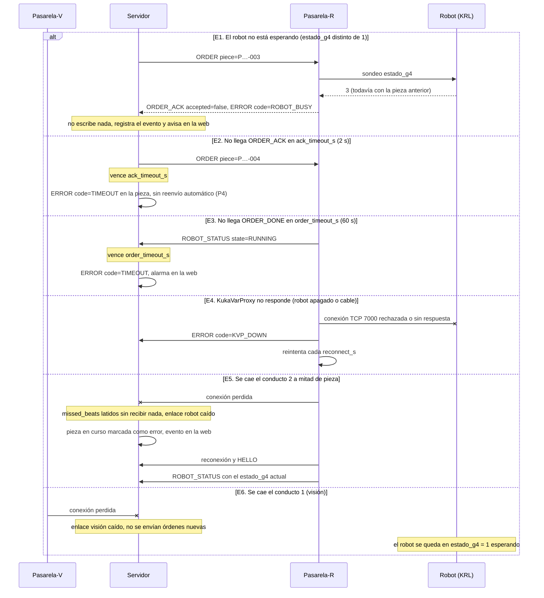

# Secuencia de una pieza (PBL 1)

**Estado:** C1 de Di (tarea 1.3). Parte del ciclo del apartado 5 de [`contratos.md`](contratos.md) y lo concreta con la variable `estado_g4` del robot (tabla en [`variables-krl.md`](variables-krl.md)). Lo marcado *por confirmar* se cierra con Robótica y Visión.

GitHub dibuja los diagramas a partir del texto Mermaid; para editarlos basta con cambiar el texto.

## 1. Ciclo normal

La pasarela del robot (pasarela-R) sondea `estado_g4` cada `robot.poll_ms` (200 ms) por KukaVarProxy. Solo escribe en `estado_g4` cuando vale 1 (robot esperando a la cámara).

La pieza mala es igual con `routine=BAD` y `estado_g4 = 4`.

## 2. El OCR no lee la pieza: giro del eje 6

Si Visión no consigue leer el código, el robot gira la pieza 15° en el eje 6 y se vuelve a capturar. Se repite hasta 23 giros (345° en total), lo que basta para ver la pieza entera. La pieza conserva su identificador.

## 3. Casos de error

El programa del robot no tiene estados de error propios en `estado_g4`. Los casos de esta sección son fallos de comunicación entre los nodos y de tiempos del protocolo.

## 4. Confirmado con la prueba real

Con HALCON, el robot y el servidor básico:

- Al terminar la rutina de pieza buena o mala, el robot vuelve a `estado_g4 = 0`; tras girar, a `estado_g4 = 1`.
- La cámara captura cuando el robot está en `estado_g4 = 1`.
- El giro llega hasta 345° (23 giros de 15°).

## 5. Pendiente

1. **Clases del protocolo (para DL).** `contratos.md` usa `class` = `A`, `B` o `REJECT`; el robot trabaja con pieza buena, mala o girar. Propuesta: `class` = `GOOD`, `BAD` o `ROTATE` y `ORDER.body.routine` con los mismos valores (3, 4 y 2 en `estado_g4`).
2. **Aviso a Visión (para DL).** Como la cámara captura cuando el robot espera, el servidor tiene que avisar a la pasarela-V de que el robot está en `estado_g4 = 1` (por ejemplo, reenviándole `ROBOT_STATUS`). Ese mensaje del servidor a la pasarela-V no está todavía en `contratos.md`.
3. **Pieza sin leer tras 345°.** Con la prueba no ha pasado; propuesta: se trata como pieza mala (`routine=BAD`).
