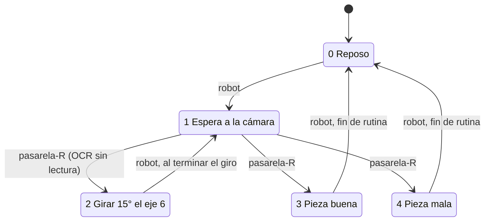

# Variables KRL del robot (PBL 1)

**Estado:** C1 de Di (tarea 1.6). Recoge las variables que usa el programa KRL de Robótica, tal como funcionó en la prueba con HALCON, el robot y el servidor básico. Sirve para la pasarela del robot (1.4) y para el simulador de robot (1.6). Lo que queda abierto está en el apartado 6.

## 1. Cómo se accede

La pasarela del robot (pasarela-R) lee y escribe variables por **KukaVarProxy** (TCP 7000 en la controladora, `robot.kvp_host` y `robot.kvp_port` en `config/ejemplo.ini`). KukaVarProxy **solo ve variables globales**, las declaradas en `$config.dat`. Las variables locales de un programa (`.src` / `.dat`) no se pueden leer ni escribir desde la red.

## 2. Tabla de variables

| Variable | Tipo | Ámbito | Escribe | Lee | Uso |
|---|---|---|---|---|---|
| `estado_g4` | `INT` | global (`$config.dat`) | robot y pasarela-R | pasarela-R | Máquina de estados del ciclo de pieza (apartado 3) |
| `p_good_cnt` | `INT` | **local** | robot | -- | Contador de piezas buenas. Hoy no accesible por KukaVarProxy |
| `p_bad_cnt` | `INT` | **local** | robot | -- | Contador de piezas malas. Hoy no accesible por KukaVarProxy |

## 3. Valores de `estado_g4`

| Valor | Significado | Lo escribe | Qué hace el robot | Mensaje del protocolo |
|---|---|---|---|---|
| 0 | Reposo | robot | Nada | `ROBOT_STATUS state=IDLE` |
| 1 | Espera a la cámara | robot | Espera una orden | `ROBOT_STATUS state=WAITING_CAMERA` |
| 2 | Girar la pieza | pasarela-R | Gira 15° el eje 6 y vuelve a 1 (hasta 345° en total, 23 giros) | `ORDER routine=ROTATE` |
| 3 | Pieza buena | pasarela-R | Rutina de pieza buena y vuelve a 0 | `ORDER routine=GOOD` |
| 4 | Pieza mala | pasarela-R | Rutina de pieza mala y vuelve a 0 | `ORDER routine=BAD` |

El programa del robot no tiene valores de error en `estado_g4`: los fallos que vigila la pasarela-R son de comunicación (ver casos de error en [`secuencia-pieza.md`](secuencia-pieza.md)).

## 4. Reglas de la pasarela del robot

1. **Solo escribe con `estado_g4 = 1`.** Antes de escribir 2, 3 o 4 lee la variable. Si no vale 1, no escribe y responde `ORDER_ACK accepted=false` con `ERROR code=ROBOT_BUSY`. Así nunca pisa una rutina en marcha.
2. **Orden nunca incompleta.** La orden es una única escritura de un `INT`, así que el robot no puede ver una orden a medias. Después de escribir, la pasarela relee la variable para confirmar que quedó el valor enviado.
3. **Fin de rutina.** La pasarela sondea `estado_g4` cada `robot.poll_ms` (200 ms). La orden termina cuando la variable deja el valor escrito: vuelve a 0 tras 3 o 4, y a 1 tras 2. Entonces envía `ORDER_DONE`.
4. **El robot es quien vuelve a reposo.** La pasarela nunca escribe 0 ni 1.

## 5. Configuración

En `config/ejemplo.ini`, la sección `[robot]` tiene hoy tres variables provisionales (`var_order`, `var_class` y `var_done`). Con esta tabla se sustituyen por una sola, `var_state = estado_g4`, junto con los valores de cada orden. El cambio se hace en el código del C2 (simulador de robot) para no dejar la pasarela y la configuración desacopladas.

## 6. Pendiente con Robótica

1. Si `p_good_cnt` y `p_bad_cnt` pasan a ser globales. Si lo son, la pasarela-R los lee (solo lectura) y la web los muestra. Si no, los contadores los lleva el servidor a partir de los `ORDER_DONE`.
2. Declaración exacta en `$config.dat` (`INT estado_g4 = 0` o `DECL GLOBAL INT estado_g4`) y valor inicial al arrancar.
